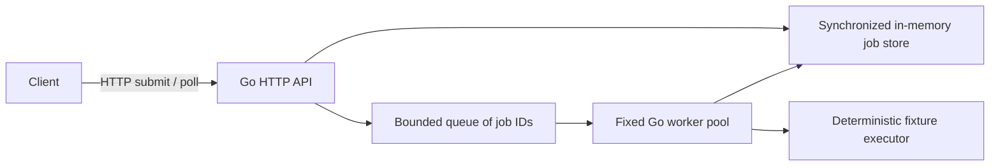

# MVP design

Status: durable execution implemented, 2026-10-17. The default API and separate
workers share PostgreSQL. The original volatile mode remains available explicitly
with `-local`. See [run.md](run.md) and [durability.md](durability.md) for the
current operating and failure contracts. Optional bounded model execution is
implemented; see [agent.md](agent.md). A local Kubernetes deployment is now
implemented; see [kubernetes.md](kubernetes.md).
Application images and the complete Compose deployment are now implemented;
see [run.md](run.md) for health, resource, and lifecycle contracts.

## Problem and example

Accept a potentially slow investigation as a job, execute it with bounded
resources, and let the caller retrieve its status, evidence, and result without
holding a connection open for the entire investigation.

The workload is read-only incident investigation using synthetic checkout service
metrics, logs, and runbooks. Fixed evidence provides known answers and
controllable failures without depending on a live service or model provider.

The first request selects a fixture, rather than accepting arbitrary text:

```http
POST /jobs
Content-Type: application/json

{"scenario_id":"checkout-db-timeout"}
```

Return `202 Accepted`, an opaque job ID, and a `Location: /jobs/{id}` header.
`GET /jobs/{id}` returns state and, when available, a structured result containing
a diagnosis and fixture evidence identifiers. A job may already be running or
finished when the submit response arrives.

The optional Gemini executor interprets a fixed task such as "Investigate
checkout's elevated error rate," chooses validated read-only fixture tools, and
synthesizes a diagnosis. Model quality and platform reliability have separate
evaluation paths. Arbitrary user tasks and live telemetry are outside this slice.

## Architecture choices

| Approach | Primary behavior | Cost and limitation |
| --- | --- | --- |
| Go API with an internal worker pool | Admission, state transitions, concurrency, deadlines | One process; all jobs disappear on restart |
| Go API and separate Go workers using PostgreSQL | Durable acceptance, competing claims, recovery, duplicate attempts | Adds SQL, leases, migrations, and another process boundary |
| Go API, broker, workers, and a result database | Messaging and independent queue operations | Adds infrastructure and a database/broker dual-write problem |

The first approach is retained for local demonstrations. The second is the
current default. Compare a broker again
only if measurements or delivery requirements justify it. Do not select NATS,
Kafka, Redis, gRPC, or an orchestration framework just to fill a component list.

### Original local slice (`-local` only)



These are components inside one Go process, not separate network services. The
fixture executor follows a fixed path. The optional model executor runs in
durable workers behind the same executor interface. Introduce Python only if a
chosen library justifies a new language boundary.

The job store owns authoritative state. Queue entries contain job IDs. Admission
must reserve capacity and publish executable work consistently: a rejected
request leaves neither a job record nor work that might run later. A single mutex
protects record creation, queue capacity, claims, and terminal transitions.
Workers wait on a condition variable; executor calls run outside the state lock.

## Volatile local-mode lifecycle and guarantees

1. Validate the bounded JSON body and known scenario ID. Malformed/unknown input
   returns `400`; an oversized body returns `413`.
2. Reserve queue and record capacity. If unavailable, return `503` with a stable
   error code and `Retry-After`; do not create a job.
3. Create the queued job, publish its ID, then return `202`. Acceptance is
   process-local and volatile in this slice.
4. An available worker transitions `queued -> running` and starts the executor.
5. Record `succeeded` with evidence, or `failed` with an inspectable error code.
   Shutdown also permits `queued -> failed`. Terminal state cannot later be
   overwritten by a late completion.
6. A caller polls the job ID. Unknown IDs return `404`; known jobs return `200`.

The defaults are two workers, up to eight waiting jobs, and at most 1,000 retained job
records per process. Queue admission counts waiting work; moving a job to running
releases its waiting slot. At most ten jobs can be waiting or running. Limits
must hold under concurrent submission, not merely in a sequential demonstration.
At the record limit, reject new work until restart; cleanup/retention is a later
design. Request bodies are bounded to 16 KiB and serialized results to 64 KiB.

Default execution timeout: five seconds starting at `running`; queue waiting is
separate. Use a service-owned job context, so returning the submit response or
disconnecting the caller does not cancel accepted work. Execution cancellation
is cooperative: the fixture executor must honor it; a context cannot forcibly
stop arbitrary code. No public cancellation endpoint in this slice.

On timeout, record `failed` / `execution_timeout`; on executor error, record
`failed` / `execution_failed`. On graceful shutdown, stop admission and allow a
bounded drain, then mark remaining jobs failed with `service_shutdown` and cancel
execution before exit. No queued job may start after the drain deadline or drain
cancellation. Default grace is ten seconds; execution timeout and shutdown grace
are configurable CLI flags.
Abrupt termination loses every job and result. There are no automatic retries.

If a submit response is lost after admission, the client cannot know whether its
job exists. Resubmission can create another job. Submission idempotency is a
later feature; do not describe this slice as reliable or durable delivery.

## Durable execution (current default)

Run separate Go API and Go worker processes. Both access PostgreSQL through a
shared job-state package. External clients use HTTP/JSON; workers use SQL for
claiming and recording jobs. This keeps the first distributed implementation
small but couples API and workers to one schema and database trust boundary.
An alternative is API-mediated worker claims over HTTP; revisit it if independent
worker languages or stricter database access boundaries become requirements.

PostgreSQL owns durable job records, results, attempt records, and queue state.
Commit admission before returning `202`. Claim work in short transactions using
row locking; never hold a database transaction open during model execution.
`SKIP LOCKED` is intended to support competing queue consumers, but it does not
provide strict FIFO fairness. See [PostgreSQL locking documentation](https://www.postgresql.org/docs/current/sql-select.html#SQL-FOR-UPDATE-SHARE).

Each claim issues a new attempt token and renewable lease. Renewals/completions
require the current unexpired ownership. Lost leases retry with backoff, capped
at three claims; confirmed execution errors/timeouts are terminal. Database time
decides ownership and validates completion. The exact retention, deadline, retry,
and ambiguous-commit rules are specified in [durability.md](durability.md).

A lost worker can keep executing after lease expiration while a replacement
starts. Conditional state updates reject stale results; they cannot prevent a
repeated external tool call or model charge. Design for possible repeated
execution and keep initial tools read-only. No exactly-once execution claim.
Client submission idempotency and worker attempt ownership solve different
problems and need separate tests.

There is no separate scheduler or worker registration service initially. Workers
pull available work; claiming grants ownership of a job. This implements simple
work distribution, not resource-aware scheduling. Transactional admission bounds
the shared backlog and retained records. Execution concurrency is two per worker
process. Bounded cleanup removes eligible terminal records after retention.

## Kubernetes mapping and scope

The existing container deployment supplies a shared API/worker image, direct
SIGTERM handling, and `/livez` / `/readyz` endpoints. Readiness includes database
reachability and drain state; it does not contact a model provider. Workers need
an explicitly enabled health listener and no inbound dispatch Service. Compose
verification exercises the existing lease contract across actual container
failure. The Kubernetes smoke test additionally covers deployment, competing
workers, API replacement, and database Pod replacement with the same volume.
Detailed worker-pod failure and drain correctness remain a separate increment.

The local kind cluster runs an API Deployment with an internal Service, a worker
Deployment with two replicas, and one PostgreSQL StatefulSet with a persistent
claim. Workers pull jobs and do not require a Service for inbound dispatch.
The fixture/Gemini overlays use separate namespaces, Secrets, and volumes.
Access is through loopback port-forwarding. A single
database with a volume is not a highly available database or a backup strategy.

Resource requests/limits and startup/readiness/liveness probes are configured.
Migration init containers reuse the existing transactional database tool.
Worker readiness is a signal for operations; application code must stop claims
during draining. Do not make liveness depend on a model provider being reachable.
Account for the Pod termination grace period in the drain policy; test actual
behavior using [Kubernetes termination guidance](https://kubernetes.io/docs/tutorials/services/pods-and-endpoint-termination-flow/).

The eventual MVP includes durable jobs, multiple workers, bounded attempts and
tool execution, one hosted model provider, fixture tools, correlation logs,
metrics/traces, and demonstrated crash recovery on Kubernetes. A hosted provider
means the project hosts agent execution, not a GPU inference engine.

Defer custom schedulers, multiple model providers, GPU serving, arbitrary code
execution, multi-agent workflows, vector databases, streaming, public hosting,
and autoscaling until the core behavior supplies a reason. Local unauthenticated
development should bind to loopback; public exposure needs a separate design.

## Concepts and evidence

- Concurrency and backpressure: show bounded workers and an overload response.
- State ownership and atomicity: rejected jobs never run; accepted durable jobs
  have committed state once that milestone exists.
- Partial failure and delivery semantics: demonstrate the completion/acknowledgment
  crash window and possible repeated attempts.
- Deadlines and lifecycle: show cooperative cancellation and bounded shutdown.
- Observability: follow a job ID through attempts and tools; measure queue wait
  separately from execution time and end-to-end latency.

The local lifecycle and durable PostgreSQL contracts have automated verification.
Model-directed fixture tools are implemented with scripted and HTTP-fixture test
coverage. A manually reported live evaluation with `gemini-3.8-flash` on
2026-10-19 passed both synthetic cases and the heuristic rubric; the supplied
diagnoses appropriately distinguished observations from uncertain causes.
Broader model accuracy and consistency remain unmeasured. The real Kubernetes
smoke test passed on 2026-10-26, including preserved results across database Pod
replacement and idle Gemini initialization without provider calls. Worker-pod
crash/termination demonstrations, observability, and measurement remain future
work; no throughput or production-availability claim is made.
